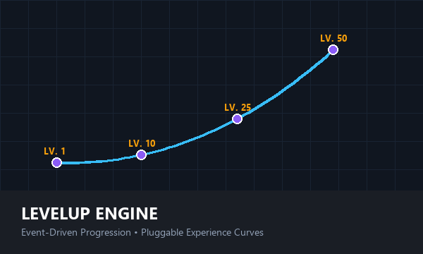

[← Back to Main Portfolio](../README.md) | [Studio Portal](https://mundane-76d8e.web.app)


# 🚀 LevelUp Engine
**The Event-Driven Progression System Compatible with Unity® & Modern C# Engines.**

Stop putting leveling logic inside your `Update()` loop. The LevelUp Engine provides a clean, decoupled architecture to manage experience, levels, and stat curves.



## Key Features
* ✅ **Strategy Pattern:** Swap leveling math (Linear, Exponential, MMO) instantly via Inspector.
* ✅ **Event-Driven:** UI updates automatically without polling.
* ✅ **Scalable:** Built for projects that plan to grow.

## Code Preview
```csharp
// Clean, readable API designed for Senior Engineers
public void AddExperience(int amount)
{
    _currentXp += amount;
    
    // UI updates automatically via Events
    OnExperienceChanged?.Invoke(_currentXp);
    
    CheckLevelUp();
}

```

---

## 📧 Contact & Support

For bug reports, feature requests, or documentation questions:

**Email:** [alkiren44@gmail.com](mailto:alkiren44@gmail.com)
