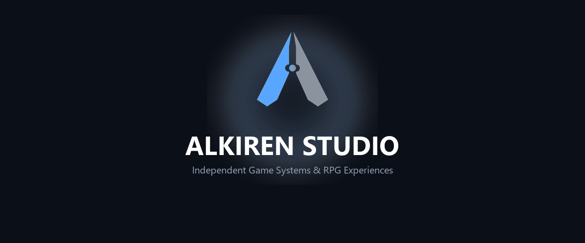
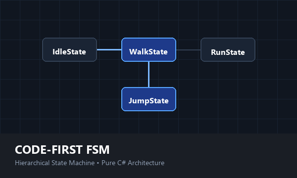
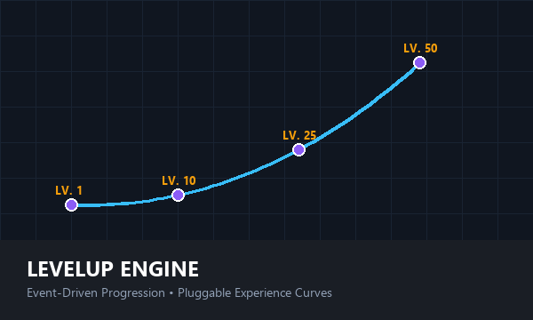
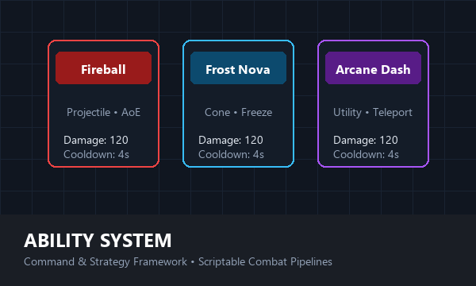

# Professional Architecture Tools & Games
We build robust, event-driven systems to eliminate spaghetti code and craft immersive gameplay experiences. Our code follows strict industry standards (**SOLID**, **Strategy Pattern**, **Observer Pattern**) for serious engineers.

---

## 🛠️ Products & Projects

| Product | Description |
| :--- | :--- |
| **[Mundane: Fantasy Task & Companion RPG](https://mundane-76d8e.web.app)** | **[Mundane (Android RPG)](https://mundane-76d8e.web.app)** A companion-driven task RPG for Android. Transform everyday tasks and errands into high-stakes fantasy quests with creature progression and procedural chronicles.  👉 [Privacy Policy](privacy-policy.html) \| [Delete Account](delete-account.html) |
|  | **[Code-First FSM](Code_First_FSM/README.md)** A strict Hierarchical State Machine (HFSM) for building complex AI and character logic without boolean flags.  👉 [View Documentation](Code_First_FSM/README.md) |
|  | **[LevelUp Engine](LevelUp/README.md)** An event-driven progression system that decouples UI from math. Swap leveling strategies instantly.  👉 [View Documentation](LevelUp/README.md) |
|  | **[Data-Driven Abilities](Ability_System/README.md)** A professional Command & Strategy framework for RPG combat. Create spells and status effects without writing code.  👉 [View Documentation](Ability_System/README.md) |

---

## 📧 Contact & Support

For bug reports, feature requests, or privacy inquiries:

**Email:** [alkiren44@gmail.com](mailto:alkiren44@gmail.com)  
**Portal:** [https://mundane-76d8e.web.app](https://mundane-76d8e.web.app)
